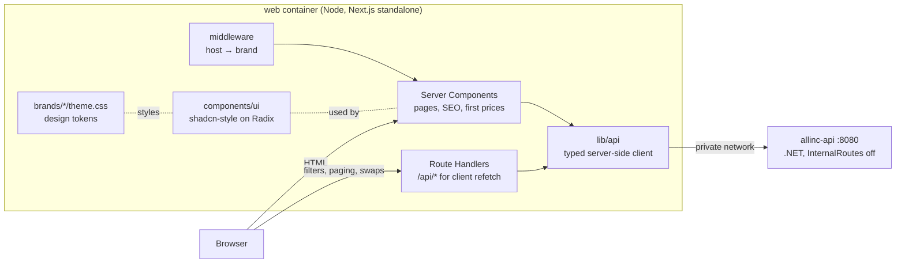
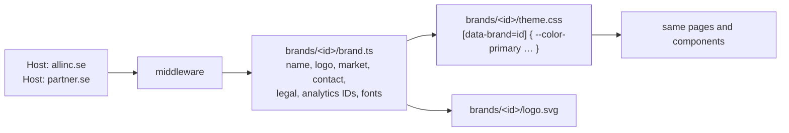
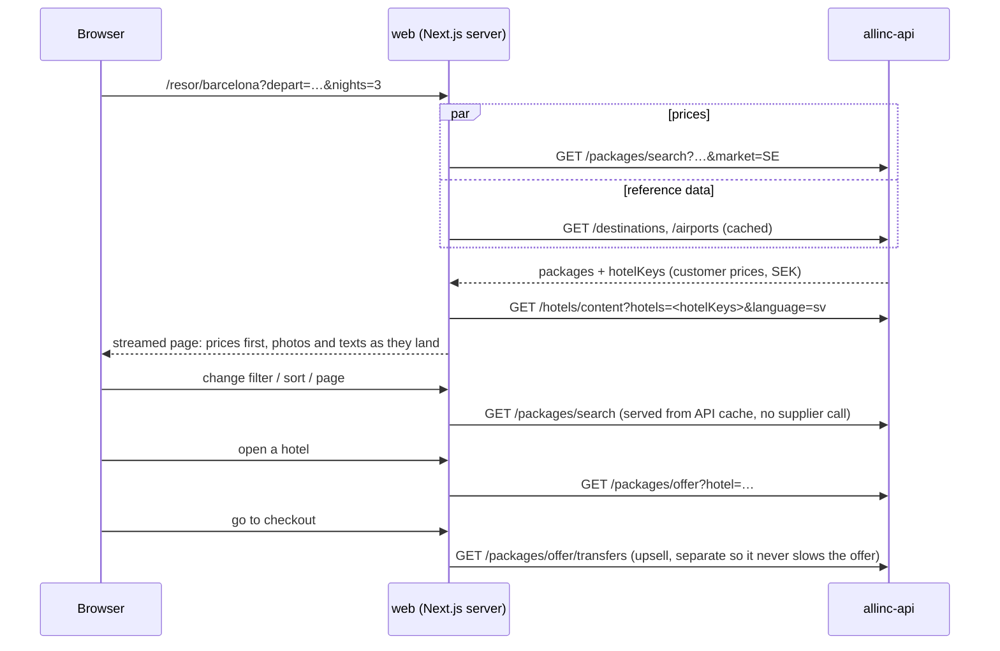

# Allinc web: foundation

Public booking site for Allinc and in-house white labels. Look and feel modelled on
heyholiday.com. Next.js + TypeScript, its own container. Written 2026-11-14 as the plan; the first
slice is now built in this repo (see README.md), and section 6 and 7 reflect what was built.

## 1. What heyholiday is built with (checked 2026-11-14)

**Answer: custom, no component library.** An Angular single-page app with hand-written CSS.

| Finding | Evidence (fetched HTML, `main`, `polyfills`, `scripts`, `styles` bundles) |
|---|---|
| Angular SPA, rendered in the browser | Empty `<app-root>`; `ɵcmp` and `ngOnInit` in `main-*.js`; zone.js in `polyfills-*.js`; Angular CLI esbuild file names (`/app/dist/generic/main-33AFOC36.js`) |
| No UI kit | No Angular Material, PrimeNG, ng-bootstrap, Tailwind, MUI, Chakra, Radix etc. Only Angular CDK overlay classes (`cdk-…`) for popups |
| Hand-written CSS | One global stylesheet, Angular scoped styles (`_ngcontent`), plain names (`.cta-btn`, `.search-result-card`, `.card-wrapper`) |
| Light design tokens | ~90 CSS variables (`--main-blue #1668e3`, `--main-color #e73e45`, `--dark-blue`, `--border-radius-big 14px`, per-product `--holiday-element-color`, `--cruise-element-color`) |
| Other libraries | Swiper (carousels), jQuery 3.7.1, Lato from Google Fonts, Google Places, reCAPTCHA + Turnstile, SignalR for live search |
| Images | Cloudflare Images (`imagedelivery.net/…/format=auto`) plus their own `imageapi` |
| Platform | ASP.NET backend behind Cloudflare; runs on AgentPath (`content.agentpath.com`, `rtc.agentpath.com`); `isMasterSite` flag and a commented skicompare.com URL in `/settings-js` |

Inferences, not proven: the 930 KB inline `spa_site_map` with `DocumentType` fields looks like
an Umbraco-style CMS tree; `prerenderReady` suggests a prerender service feeds HTML to search
bots, because the real page has no server-rendered content. The flags above suggest they also run
several branded sites on one codebase, the same need we have.

**What we take from it:** the visual language (photo-led hero with a search box, rounded image
cards, carousels of destinations, clear blue CTAs, a calm white page). **What we don't:** their
stack. A browser-only SPA is weak for SEO, and we have no reason to copy their colours or font.

## 2. Recommended stack



| Layer | Choice | Why |
|---|---|---|
| Framework | Next.js (App Router), TypeScript, `output: "standalone"` | Server-rendered pages for SEO, streaming for slow supplier calls, one small Docker image |
| Styling | Tailwind CSS v4 with every colour, radius, font and shadow as a CSS variable | Tokens make white labels a theme file, not a fork |
| Components | shadcn/ui pattern: we own the component code, built on Radix primitives | Lets us draw heyholiday's custom look exactly (a UI kit would fight it) while Radix gives accessible dialogs, popovers, selects |
| Carousel / dates / icons | Embla, react-day-picker, Lucide | Replace Swiper, jQuery and icon fonts with small, headless pieces |
| Client data | TanStack Query against our own `/api/*` | Cheap refetch when filters change (the API already filters from cache) |
| Images | `next/image` with a custom loader | Hotel photos from `/hotels/content`; our own editorial photos via an image CDN (Cloudflare Images works, like heyholiday) |
| Fonts | `next/font/google`: **Quicksand** headings, **Inter** body | Free, open licence, self-hosted at build time (no Google call from the visitor's browser) |

## 3. White labels

One build serves every brand. The request's host picks the brand; the brand is just config.



- Components only use tokens (`bg-primary`, `rounded-card`, `font-heading`), never raw colours.
- A brand file sets the defaults it needs; anything it leaves out falls back to Allinc's.
- Brand-specific copy and legal pages are content, not code (CMS choice comes later).
- Each brand sends its `market` to the API, so prices come back in its currency.

## 4. How the site uses the backend

Prices and content are separate calls. The site only ever sees customer prices.



Rules:

- The browser never calls `allinc-api` directly; the web server does, over the Docker network.
- Production API runs with `InternalRoutes__Enabled=false`, so `/ops/*`, `/hotels/search`,
  `/flights/*` and supplier prices are 404 even if someone tries.
- Typed client in `lib/api`, one function per public route. Later generate the types from an
  OpenAPI document once the API exposes one.
- Search results are not cached by the web layer (the API owns caching); content and
  destination pages are cached with Next's revalidation.

## 5. Brand and logo

From the "Modernize the logo for 2026" thread: **direction D** is picked. A blue disc with a flat
yellow ribbon sweeping across it, plus a rounded graphite wordmark.

| Token | Value |
|---|---|
| Sea (primary) | `#1C9AD6` |
| Sun (accent) | `#FFC629` |
| Graphite (text) | `#2A3136` |
| Headings / body | Quicksand / Inter (Google Fonts, free) |

- The logo letters are drawn shapes, not a font, so the logo needs no licence.
- Decided 2026-11-14: lowercase "allinc" in the Sky palette (dot `#3DB8EE` to `#1382C8`, ribbon
  `#FFB81F` to `#FFD84A`, graphite word).
- Final files are in `public/brands/allinc/`: `logo.svg` and `logo-white.svg` (white word for dark
  backgrounds), `logo-one-colour.svg` and `logo-one-colour-white.svg`, `symbol.svg`, PNG copies
  (`logo.png`, `logo-white.png`, `icon-192.png`, `icon-512.png`), `apple-touch-icon.png` and
  `favicon.ico`. `app/favicon.ico` is the same Allinc icon. The apple touch icon is not wired into
  the page metadata yet.
- No paid fonts for any brand: white labels pick from Google Fonts or other open-licence fonts.

## 6. Shape of the repo (as built)

The web is its own repo, `allinc-web`, next to `allinc` (the backend).

```
allinc-web/
  app/[brand]/        pages per brand: home, sok (results), resa/[ref] (offer), kassa/[ref] (checkout)
  app/bild/[token]/   image proxy: supplier photo hosts never reach the browser
  proxy.ts            Host -> brand rewrite (Next 16 renamed middleware to proxy)
  brands/<id>/        brand.ts, theme.css (+ logo in public/brands/<id>/)
  components/ui/      owned primitives (button, card, badge)
  components/         site blocks (search form, flight line, checkout pieces)
  lib/server/         API client, sealed refs, public view models (server-only)
  dev/fixtures/       one recorded Barcelona search for offline work (ALLINC_API_MODE=replay)
  Dockerfile          node:22-alpine, standalone output, port 3000
  docker-compose.yml  api (internal routes off, no host port) + web
```

## 7. Build steps

1. Done: scaffold (Next.js 16, Tailwind 4 tokens, fonts, Docker image), two brands.
2. Done: search -> results -> offer (swap room/flight) -> dummy checkout with transfer suggestion.
3. Next: home page in the heyholiday layout (destination carousel, category blocks, real photos).
4. Next: real booking flow (price re-check, traveller details via a server action, payment).
